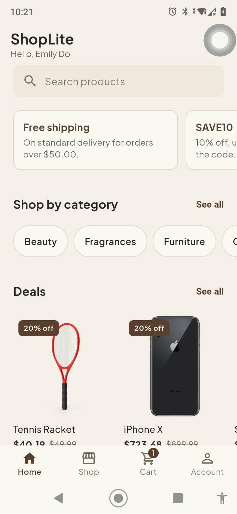
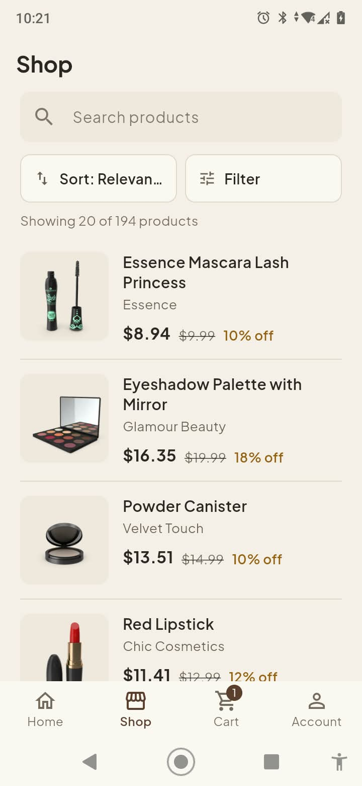
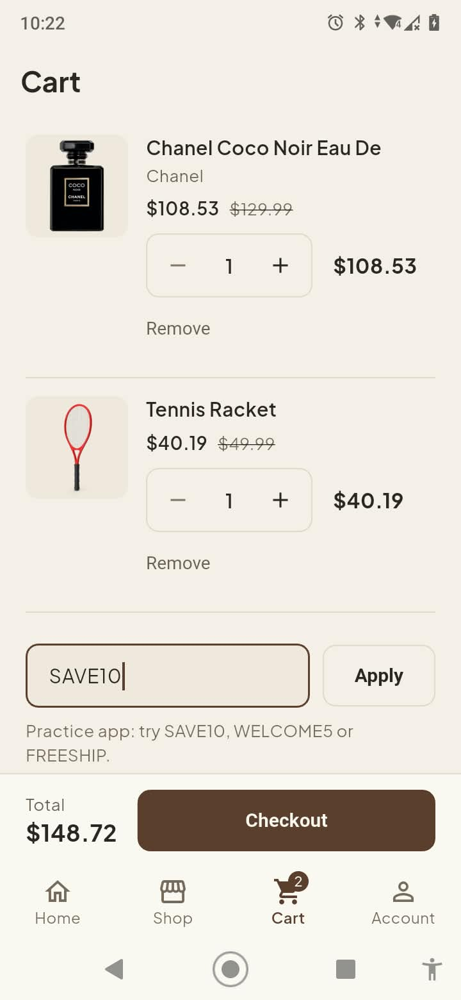
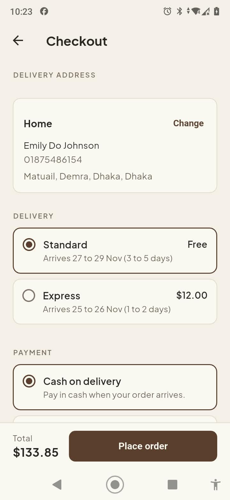
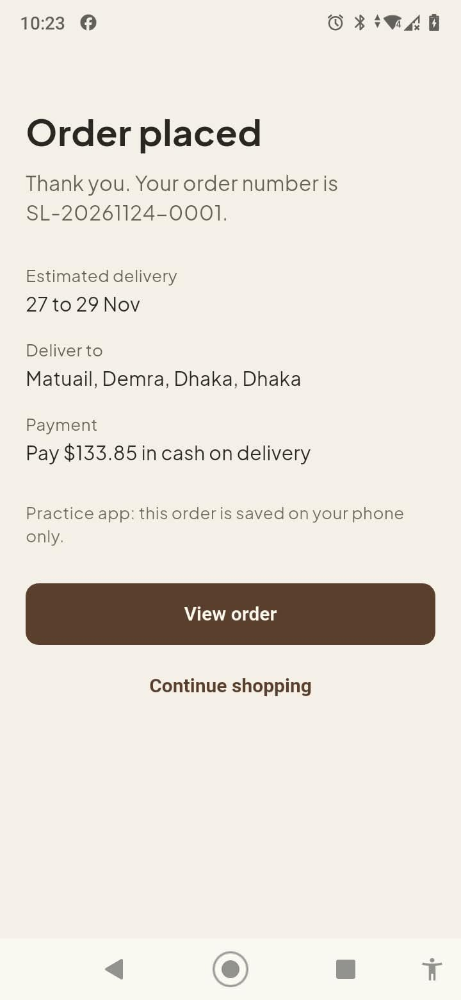
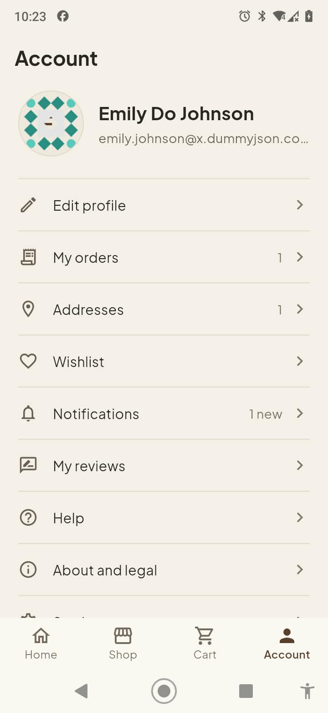
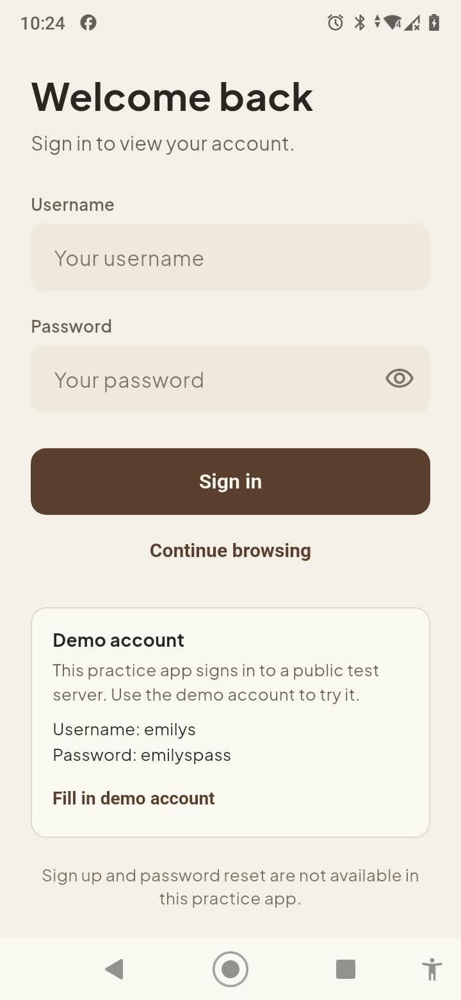
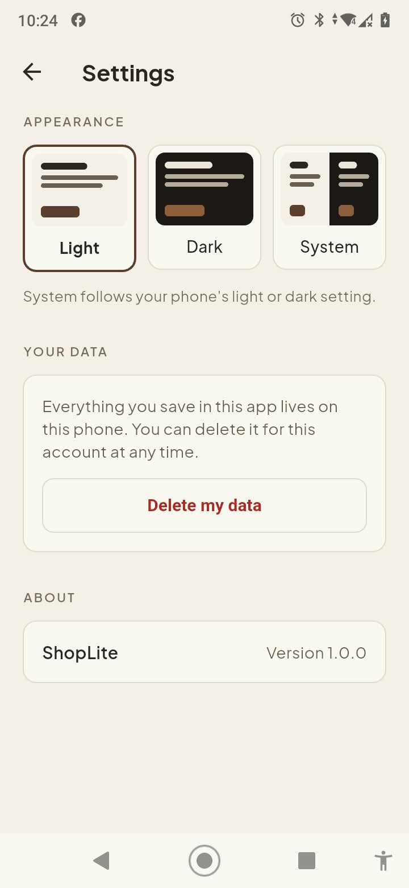
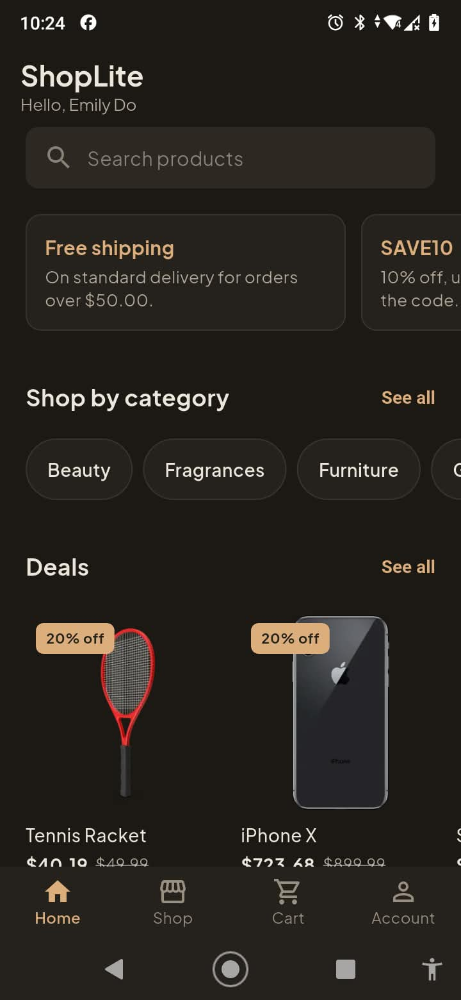

# ShopLite

[](https://github.com/RainulRafi/shoplite/actions/workflows/ci.yml)
[](LICENSE)

A shopping app for Android, built with Flutter to practice building a whole product end to end:
browsing, a cart that works without an account, checkout, orders and an account area.

It is a practice app. Nothing is charged and nothing is delivered. The section
"What is real and what is simulated" below says exactly which parts are which.

<table>
  <tr>
    <td align="center"><br><sub>Home</sub></td>
    <td align="center"><br><sub>Sort and filter</sub></td>
    <td align="center"><br><sub>Product</sub></td>
    <td align="center"><br><sub>Cart and coupon</sub></td>
    <td align="center"><br><sub>Checkout</sub></td>
  </tr>
  <tr>
    <td align="center"><br><sub>Order timeline</sub></td>
    <td align="center"><br><sub>Account</sub></td>
    <td align="center"><br><sub>Sign in</sub></td>
    <td align="center"><br><sub>Settings</sub></td>
    <td align="center"><br><sub>Dark theme</sub></td>
  </tr>
</table>

## Try it

Download the [APK](https://github.com/RainulRafi/shoplite/releases/latest).
It is signed with the standard debug key, so Android may ask you to confirm the install.

Sign in with the demo account from the test service's public documentation:
username `emilys`, password `emilyspass`. The sign in screen has a button that fills them in.

## What it does

- A home page with categories, deals, top rated products and recently viewed products
- Search with recent searches; sort and filter by category, price, rating and stock
- Product pages with customer reviews from the server, plus reviews you write yourself
- A cart that works without an account and merges into your own cart when you sign in
- Coupons and shipping rules, with free shipping progress in the cart
- Checkout with an address, a delivery option and a payment option. Prices and stock are
  checked again before the order is placed
- Order history, a status timeline, cancelling until an order ships, and ordering again
- Sign in with automatic token refresh, an editable profile, an address book, a wishlist,
  notifications about your orders, light and dark themes, help, terms and a privacy policy
- "Delete my data", which removes everything saved for your account from the phone

## What is real and what is simulated

| Part | Real or simulated |
|---|---|
| Products, categories, search, server reviews, sign in, token refresh | Real requests to the public [DummyJSON](https://dummyjson.com) service |
| Cart, addresses, wishlist, orders, your reviews, history, profile edits | Real, saved in a SQLite database on the phone. There is no server of my own |
| Cash on delivery | Behaves like the real thing |
| Online payment | A demo screen. It asks for no card details and can be set to succeed or fail |
| Order status changes | Simulated on a timer of a few minutes, so the whole journey fits in one sitting |
| Product stock | Checked before ordering, but the test service cannot be told to lower it |

## How it is built

The code is organised by feature, and each feature has up to three layers:

```
Screens and Providers   presentation/   what the user sees and the state behind it
Rules                   domain/         plain Dart: pricing, coupons, merging, filtering, order status
Storage and API         data/           repository interfaces, with an API or SQLite implementation
```

```
lib/
  core/        network client, database and migrations, money type, theme, shared widgets
  features/
    products/ cart/ orders/ auth/ addresses/ wishlist/ profile/
    home/ browsing/ reviews/ notifications/ settings/ help/ shell/
```

Screens talk to Providers, and Providers talk to repository interfaces. Because of that, the
SQLite storage could be replaced by a real backend without touching a screen.

### Decisions I would explain in an interview

- **Money is whole cents** in a small value type, never a double, so totals never drift.
- **Placing an order is one database transaction** that saves the order and its items and
  empties the cart. A failure rolls everything back. Each checkout attempt has an idempotency
  key, so a double tap or a lost reply cannot create two orders.
- **Orders keep a snapshot** of the address and the prices at purchase time, so later edits do
  not change history.
- **A guest cart merges into the user cart in one transaction** at sign in, using a pure function.
- **Cart writes are queued.** The screen updates at once and the database is written in order,
  so fast taps are never lost. A failed write re-reads the database.
- **Order status and notifications are calculated from time**, not stored, so they can never
  disagree with the order.
- **Filtering and sorting happen on the phone** for what the server cannot do. That suits a
  catalog of about 200 products and would not scale. A large catalog needs the server to filter.
- **Late replies are ignored** with a generation counter, so a slow old search cannot
  overwrite a newer one.
- **Deleting data is guarded by a test** that walks every table with an owner column and fails
  if one is missing from the erase list.
- **Sign in tokens** are kept in the phone's secure storage and refreshed once when a request
  gets a 401. Only a rejected refresh token signs the person out, never a lost connection.

### A bug the tests did not catch at first

The API address was read in two places, and the network client read it without a default
value. With a plain `flutter run` every request went out with no host and failed quietly with a
generic message. All the tests used a fake server, so none noticed. The address and timeouts now
live in one `AppConfig`, and a test checks that the client really uses it.

## Tests

- Unit tests for money, pricing, coupons, merging, filtering, order status and notifications
- Repository tests against a real SQLite database in memory, including the migrations
- Provider tests, including race conditions and failed writes
- Widget tests for the main screens, and Flutter's accessibility guidelines (tap target size,
  labels, text contrast)
- A flow test that drives the real app on a phone: browse, add to cart, check out, find the order

There are [N] automated tests with [X]% line coverage.

Every pull request runs `flutter analyze`, `flutter test` and a debug build on GitHub Actions.
The phone flow test is not part of CI.

```
flutter pub get
flutter analyze
flutter test
flutter test integration_test/app_flow_test.dart -d <device id>
```

## Run it

You need Flutter and an Android device or emulator.

```
flutter pub get
flutter run
```

Optional settings:

- `--dart-define=API_BASE_URL=https://dummyjson.com` to point at another server
- `--dart-define=ACCESS_TOKEN_MINUTES=1` to make tokens expire quickly and watch the refresh work

`docs/api.http` has the requests I used to check the API by hand.

## Known limitations

- Android only. I have not built or tested it for iOS or the web
- Carts, addresses and orders live on one phone and do not sync between devices
- Delivery is simulated and online payment is a demo screen
- The test service cannot lower stock, so ordering does not reduce it
- Sorting and filtering on the phone only suit a small catalog
- Addresses use Bangladeshi divisions and mobile numbers only
- Sign up, password reset and changing your email are not possible with the test service.
  Profile edits are saved on the phone only
- Data on the phone is not encrypted beyond the sign in tokens, which use the phone's secure storage
- No push notifications. Notifications appear inside the app
- The interface is in English only
- The phone flow test is not run by CI

## What I would do next

- Replace the SQLite repositories with a real backend, which the repository interfaces allow
- Move one feature from Provider to Riverpod to compare the two
- Add Bangla text and deep links

## Privacy

The app keeps your data on the phone and sends only sign in and product requests to the test
service. It has no analytics, advertising or crash reporting. The full text is in the app under
Account, About and legal.

## Credits

Product data and sign in come from [DummyJSON](https://dummyjson.com). The app font and the
letter on the icon are [Plus Jakarta Sans](https://fonts.google.com/specimen/Plus+Jakarta+Sans)
(SIL Open Font License). The icon was drawn for this project.

## License

[MIT](LICENSE)
